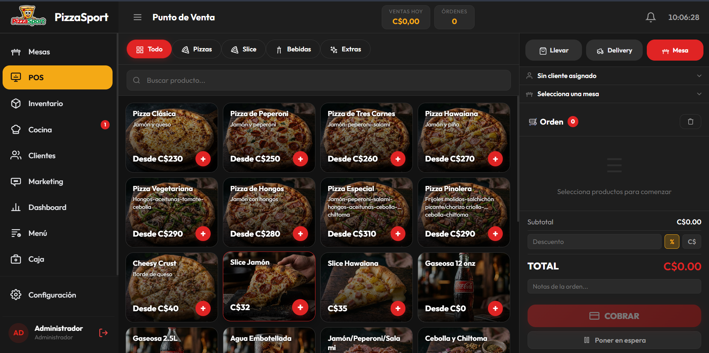
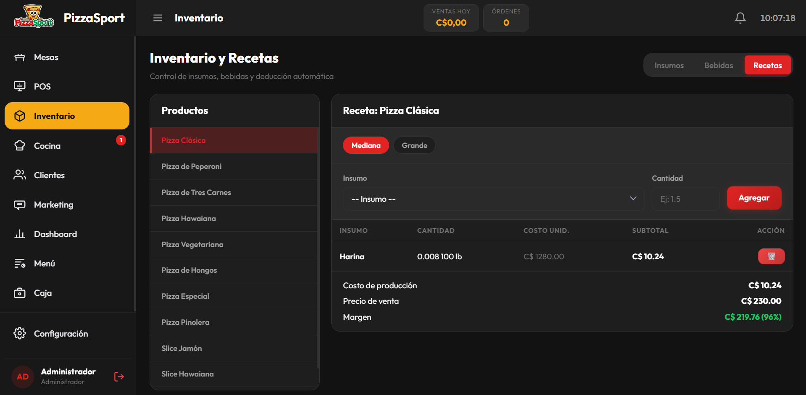
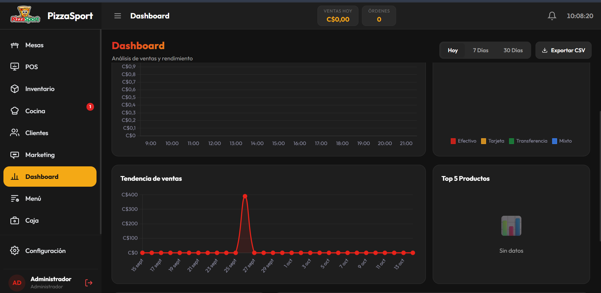
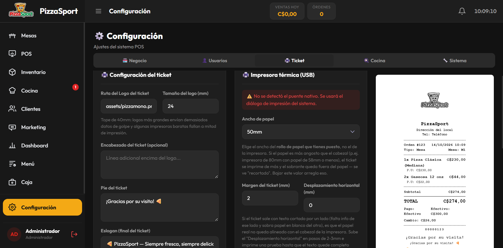

# PizzaSport POS

Sistema de punto de venta web para pizzerías. Permite tomar pedidos, gestionar mesas y caja, enviar órdenes a cocina y controlar productos, inventario y recetas desde una interfaz adaptable a escritorio y tablet.

> Interfaz en español. El frontend está hecho con HTML, CSS y JavaScript nativo; Express y SQLite proporcionan la API y el almacenamiento compartido.

## Capturas

| Punto de venta | Inventario y recetas |
| --- | --- |
|  |  |

| Dashboard de ventas | Configuración e impresión de tickets |
| --- | --- |
|  |  |

## Funcionalidades

- **Punto de venta:** pedidos para mesa, llevar y delivery; búsqueda y categorías de productos; descuentos, notas, pagos y órdenes en espera.
- **Mesas y cocina:** seguimiento del estado de mesas y visualización de órdenes para su preparación.
- **Caja:** apertura y cierre de sesiones, registro de ventas y movimientos.
- **Menú:** administración de productos, categorías, precios y disponibilidad.
- **Inventario y recetas:** gestión de insumos y bebidas, costos de recetas y deducción de inventario asociada a ventas.
- **Clientes y marketing:** registro de clientes y herramientas de campañas.
- **Dashboard:** indicadores y tendencias de ventas, con exportación CSV.
- **Usuarios y roles:** perfiles de administrador y cajero, con permisos de acceso distintos.
- **Tickets:** impresión desde el navegador y, en Android, puente USB ESC/POS para impresoras térmicas compatibles.
- **PWA:** shell web con manifest y service worker para instalación en dispositivos compatibles.

## Requisitos

- Node.js 20 o posterior y npm, para ejecución directa.
- Alternativamente, Docker con Docker Compose.
- Para usar la app Android: Android Studio y una tablet/dispositivo Android. La app se conecta a un servidor PizzaSport POS en la misma red.

## Ejecutar localmente

```bash
git clone <URL_DEL_REPOSITORIO>
cd pizzasport
npm ci
npm start
```

Abre [http://localhost:3000](http://localhost:3000). En el primer arranque se crean la base SQLite y los usuarios iniciales.

### Configuración de inicio

El puerto se configura con `PORT` (por defecto `3000`). Antes del primer arranque con una base vacía, define `ADMIN_PIN` y `CASHIER_PIN` con valores propios, numéricos y de exactamente 4 dígitos. No hay PIN predeterminados en el código. Estas variables solo crean los usuarios iniciales; luego, cambia los PIN desde la configuración de usuarios.

En PowerShell, antes del primer arranque:

```powershell
$env:ADMIN_PIN = "<PIN_ADMIN_DE_4_DIGITOS>"
$env:CASHIER_PIN = "<PIN_CAJERO_DE_4_DIGITOS>"
npm start
```

En macOS/Linux:

```bash
ADMIN_PIN='<PIN_ADMIN_DE_4_DIGITOS>' CASHIER_PIN='<PIN_CAJERO_DE_4_DIGITOS>' npm start
```

La configuración del proyecto no carga `.env` automáticamente al ejecutar `node server.js`; define las variables en el entorno de la terminal. En cambio, Docker Compose sí lee `.env`.

Si la base está vacía y falta alguno de los PIN o no tiene el formato requerido, el servidor no creará los usuarios y mostrará el error en sus logs. Si los usuarios ya fueron creados, cambiar las variables de entorno no modifica sus PIN: actualízalos desde la configuración de usuarios de la aplicación.

## Ejecutar con Docker

En macOS/Linux:

```bash
cp .env.example .env
```

En PowerShell:

```powershell
Copy-Item .env.example .env
```

Edita `.env` para establecer PIN iniciales propios y luego ejecuta:

```bash
docker compose up --build -d
```

Abre [http://localhost:3000](http://localhost:3000). Para cambiar el puerto del host, define `HOST_PORT` en `.env`. Docker Compose conserva la base de datos y los respaldos en el volumen `pizzasport_data`; los datos sobreviven al reinicio o recreación del contenedor.

Comandos útiles:

```bash
docker compose logs -f       # Ver los logs
docker compose ps            # Ver el estado del servicio
docker compose down           # Detener el servicio, conservando el volumen
```

## Cómo funciona

```text
Navegador / app Android
        │ HTML, CSS, JavaScript y API HTTP
        ▼
    Express (server.js)
        │
        ▼
 SQLite (database.sqlite)
```

1. **Interfaz:** `index.html` carga los estilos de `css/` y los scripts de `js/` en un orden definido. No hay framework, bundler ni paso de compilación. Los módulos del navegador manejan las pantallas y llaman a la API.
2. **Arranque y navegación:** `js/app.js` inicializa la app, presenta el acceso por usuario/PIN y dirige a los módulos. La interfaz tiene módulos para POS, mesas, cocina, clientes, marketing, dashboard, menú, caja, inventario y configuración.
3. **Persistencia:** `js/db.js` mantiene el estado de la aplicación y lo sincroniza con Express. `js/state.js` contiene el estado temporal de la interfaz y el carrito.
4. **API y autenticación:** `server.js` sirve una allowlist de archivos estáticos y expone la API `/api`. Las sesiones se validan con token; los PIN no forman parte de la respuesta de estado. Los endpoints de sincronización requieren sesión y las operaciones de reinicio requieren rol administrador.
5. **Base de datos:** SQLite usa una tabla `store` como almacenamiento de documentos clave/valor JSON. El servidor habilita WAL, sincroniza el estado entre pestañas/dispositivos y resuelve operaciones críticas como la apertura de caja y el contador de órdenes en el backend.
6. **Copias y archivo:** se intenta crear un respaldo SQLite al iniciar y cada 24 horas, conservando hasta 14 archivos. Los pedidos de más de 180 días se archivan en SQLite y no se incluyen en la sincronización normal del estado.
7. **Android:** el proyecto en `android/` carga la interfaz del servidor en un WebView y ofrece `AndroidPrinter` para imprimir tickets ESC/POS por USB.

El navegador consulta periódicamente el estado compartido. La mayoría de escrituras se sincronizan por clave; las operaciones de lista y caja tienen rutas específicas para reducir conflictos entre dispositivos. Para un cambio simultáneo de la misma entidad, la app prioriza la última escritura recibida.

## Estructura del proyecto

```text
server.js                 Servidor Express, API, autenticación y SQLite
index.html                Shell de la interfaz
css/                      Estilos por pantalla y componentes
js/app.js                 Arranque, autenticación y navegación
js/db.js                  Acceso y sincronización de datos
js/state.js               Estado temporal de la interfaz y carrito
js/modules/               Módulos funcionales del POS
js/utils/                 Impresión, notificaciones, gráficos y utilidades
assets/, img/             Recursos gráficos de la aplicación
images/                   Capturas incluidas en esta documentación
android/                  Cliente Android y puente de impresora USB
Dockerfile                Imagen Docker del servidor
docker-compose.yml         Servicio y volumen persistente
.env.example              Plantilla de variables para Docker Compose
```

## API principal

Las rutas de autenticación permiten seleccionar usuario y abrir/cerrar sesión. El resto de rutas de datos requiere un token de sesión en `Authorization: Bearer <token>`.

| Método | Ruta | Propósito |
| --- | --- | --- |
| `GET` | `/api/login-users` | Lista pública mínima de usuarios activos, sin PIN. |
| `POST` | `/api/login` | Valida usuario y PIN; devuelve un token de sesión. |
| `POST` | `/api/logout` | Cierra la sesión actual. |
| `GET` | `/api/state` | Obtiene el estado persistido de la aplicación. |
| `POST` | `/api/sync` | Guarda un valor asociado a una clave. |
| `POST` | `/api/sync-item` | Inserta, actualiza o elimina un elemento de una lista. |
| `POST` | `/api/next-order-number` | Obtiene el siguiente número de orden. |
| `POST` | `/api/open-cash-session` | Abre una sesión de caja si no hay otra abierta. |
| `POST` | `/api/reset-sales` | Reinicia datos de ventas; requiere administrador. |
| `POST` | `/api/reset` | Reinicia el estado guardado; requiere administrador. |

## Aplicación Android

El proyecto nativo está en `android/`; sus instrucciones de compilación, configuración de URL del servidor, primer uso USB y diagnóstico de impresoras están en [`android/README.md`](android/README.md). En Android Studio, abre esa carpeta y configura la URL/IP del servidor antes de ejecutar la app en la tablet.

## Datos y seguridad

- La base SQLite (`database.sqlite`), sus archivos auxiliares, los respaldos y `.env` se excluyen de Git. Cada instalación crea sus propios datos; el repositorio contiene solo código y recursos.
- Los PIN de arranque se proporcionan mediante variables de entorno y no se guardan en el repositorio. Protege la base de datos y sus respaldos, ya que contienen los datos de operación y usuarios.
- El servidor sirve HTTP. Para acceder desde fuera de una red local, configura HTTPS y controles de acceso adecuados delante de la aplicación; no expongas directamente el puerto a Internet.
- La sesión vive en memoria del servidor y expira a las 12 horas. Reiniciar el proceso invalida las sesiones existentes, pero no elimina los datos SQLite.
- Chart.js y las fuentes web se cargan desde CDN; se necesita conexión a Internet para descargar esos recursos cuando no están en caché.

## Desarrollo

El frontend se sirve directamente desde Express; tras editar archivos, recarga la página. El comando `npm start` ejecuta el servidor. No hay herramientas de build, lint ni suite de pruebas configuradas actualmente.

## Licencia

No se ha especificado una licencia para este repositorio.
